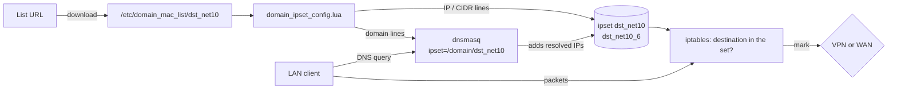

# How GL.iNet applies a list

This page explains what the router does with a list URL, which limits follow from that, and how the build shapes lists to fit. The facts come from the GL.iNet docs and from tests over SSH on a Flint 2 (GL-MT6000), firmware 4.11.0, in October 2026. Other models and firmware versions may differ, and weaker models surely have less headroom.

## From URL to routing

VPN Dashboard → Policy Mode → "Exclude specified Domain / IP List" (or the opposite mode) → a list URL. The router then works like this:



1. The firmware downloads the file to `/etc/domain_mac_list/dst_net10` and `/usr/bin/domain_ipset_config.lua` parses it. Lines it doesn't accept are skipped one by one, and the GUI reports them as "N failed to be detected, Invalid Line Number: …". The rest of the list still applies.
2. **IP and CIDR lines** go straight into an ipset: `dst_net10` (`hash:net`, IPv4) or `dst_net10_6` (IPv6).
3. **Domain lines** become dnsmasq rules `ipset=/<domain>/dst_net10` in `/var/run/dnsmasq/via_domain`. When a client resolves the domain, or any of its subdomains, through the router, dnsmasq adds the IPs from the answer to the same ipset. These entries have no timeout. They stay until the policy is restarted.
4. iptables marks packets from the devices the policy applies to (ipset `src_mac10`) by whether their destination is in `dst_net10`. Policy routing sends marked packets to the WireGuard table or to the main table. In Exclude mode the rule is `! --match-set dst_net10`: destinations outside the set go to the VPN, and listed ones go direct. If kill switch is on, packets that end up without a mark are dropped.

The firewall is iptables + ipset (fw3). `nft list ruleset` is empty on this firmware.

### What follows from this

- **A domain rule is really an IP rule, filled in by DNS.** It only works if the client asks the router's DNS. DoH/DoT in a browser or the OS, or a hard-coded DNS server, bypasses it. An answer cached on the client from before the list was loaded is not seen either. Flush the client's DNS cache after changing the list.
- **A domain covers all its subdomains**, because dnsmasq `ipset=/example.com/` matches `*.example.com`. A line `www.example.com` covers `*.www.example.com` too. That's why the build drops subdomains under a listed parent, and why v2fly `full:` becomes broader than in xray.
- **Shared IPs leak the rule to other sites.** Once a domain's IP is in the set, every site on that IP follows the rule: a CDN or shared hosting address serves many unrelated domains. In Exclude mode a Russian site behind Cloudflare can make other sites on the same Cloudflare IP bypass the VPN. This follows from how the rules work and was not tested separately; nothing in the list format can prevent it.
- **The set only grows.** Every domain a client resolves adds entries, and they stay until the policy restarts. A list with many domains fills the set over days of use, not at load time.

## Accepted entries

| Line | Accepted | Note |
|---|---|---|
| `example.com` | yes | the domain and all its subdomains |
| `www.example.com` | yes | the same: this name and everything under it |
| `192.168.10.0/24`, `1.1.1.1` | yes | IPv4 network or single address |
| `2a14:e900::/29` | yes | doesn't break the list, but whether IPv6 traffic is then routed by the policy is untested |
| `# comment` | yes | ignored |
| `ru`, `.ru`, `*.ru` | **no** | whole zones are rejected, so "everything in .ru" can't be one line |
| `_dmarc.example.com` | **no** | labels with `_` are rejected |
| `keyword:`, `regexp:` | no | no equivalent; the format is plain domains and networks |

## Limits

| Limit | Value | What happens past it |
|---|---|---|
| Lines checked by the importer | 200 000 | For a file of 1.37M lines the GUI reported exactly 200 000 (199 998 accepted, 2 rejected) and said nothing about the rest. Whether the rest is still applied is not proven: a control line at the end of the file did not take effect, but it was checked while the parser was still running and never rechecked. Treat 200 000 lines as the limit. |
| ipset size, per family | 65 536 entries | Shared by the networks from the list and the IPs of resolved domains. When full, new entries are lost silently (only `Set dst_net10 is full` in the kernel log), so domain rules stop working for sites not seen before. |
| Domain count | not measured exactly | 75K domains + 89K networks loaded, and dnsmasq grew from ~3 to ~16 MB. With 200K domains the parser held ~90 MB for minutes and the router's DNS stopped answering for the whole network while it ran. |
| Refresh | daily at 03:00 router time, if the cron job is right | The updater is `/usr/bin/update_vpn_domain.sh`. It requests the URL, compares the `ETag`, `Last-Modified` and `Content-Length` headers with the previous check, and only on a change downloads the list (20 s limit), replaces the file if the download succeeded and is not empty, and re-applies the policy. Firmware 4.11.0 schedules it with `0 3 * * * /usr/bin/update_vpn_domain.sh` in `/etc/gl_crontabs/crontabs.d/update_vpn_url`. On a router upgraded from older firmware that file may still hold the old job (`… vpnpolicy-apply restart`), which does nothing: then the list is never refreshed. See [Checking on your router](#checking-on-your-router). Read from the script on 4.11.0; a refresh with the right job has not been observed yet. |

The two hard limits are why presets are checked in the build (`options.router_max_lines` and `options.router_max_ips` in [config.md](config.md)). The default IP budget is 55 000 networks, which leaves ~10 000 entries in the ipset for resolved domains. For a preset with tens of thousands of domains that may be tight, and lowering `router_max_ips` gives more room.

Single `geosite/` and `geoip/` lists are published whatever their size. The build log names those over the limits; at the moment they are `geosite/ru-blocked-all.txt`, `geosite/antifilter-download.txt`, `geoip/ru-blocked.txt`, `geoip/us.txt`, `geoip6/us.txt` and `geoip6/nl.txt`. Don't use them on the router as they are.

## How the build shapes lists

Every step below is applied to every published list unless stated otherwise. The figures are for `ru-direct` in the October 2026 build.

1. **Keep only what the router can express.** `keyword:` and `regexp:` rules are dropped. So are whole zones (unless `options.allow_tld`), labels with `_` and malformed entries. Internationalized names are converted to punycode (`рф` → `xn--p1ai`). The build log counts what was dropped and why.
2. **Merge and deduplicate.** A preset combines categories that overlap: `ru-direct` has 2 899 rules from 23 categories, which give 1 938 distinct domains.
3. **Drop subdomains under a listed parent.** Since a line covers its subdomains, `mail.yandex.ru` adds nothing when `yandex.ru` is listed. Only parents from `domain:` rules are used for this. Children of a `full:` entry are kept: redundant on GL.iNet, but harmless. This takes `ru-direct` from 1 938 to 1 674 domains: 42% fewer lines than the source rules.
4. **Merge networks without loss.** Overlapping and adjacent networks are merged into the fewest CIDRs covering exactly the same addresses (`ipaddress.collapse_addresses`). The geoip sources are already aggregated, so this mostly matters where a preset combines several lists or local files.
5. **Merge networks with loss, only on request.** A preset with `"aggregate_ips": true` that still has more networks than `router_max_ips` gets nearby networks merged into wider ones until they fit. The merge picks the combination with the fewest extra addresses, and no network is widened beyond /16 (IPv4) or /32 (IPv6). For example, `geoip:ru-blocked` (the whole registry): 88 587 networks, 85% of them single /32 addresses, become 53 727 at the cost of 6.7% extra addresses. 50 424 networks stay as they are, and 3 303 are widened, mostly to /29–/30. Widening to a fixed prefix instead would cost far more: /29 for all of them gives 46 591 networks but +49% addresses.

   The extra addresses are matched by the policy too. In the mode where listed traffic goes **through** the VPN, that only sends a few more hosts through the tunnel. In Exclude mode it sends them **around** the VPN, so leave `aggregate_ips` off for Exclude presets.
6. **One URL per policy.** The router takes a single URL, so combinations are published as presets, and every preset is checked against the router limits and the guards against empty lists.

### Choosing a list

- Domains only cost ipset entries for sites that are actually visited; networks always cost their full count. When a service is covered by a domain list, its networks are usually not needed.
- Fewer, broader domains beat many narrow ones: `example.com` covers what a hundred subdomain lines would.
- If domain rules don't work on a router (the DNS caveats above), an IP-only preset such as `ru-direct-ip` is the fallback.

## Checking on your router

Over SSH (`ssh root@<router IP>`):

```sh
cat /etc/domain_mac_list/dst_net10                  # the list as downloaded
head /tmp/dnsmasq.d/via_domain                      # domains as dnsmasq rules
ipset list dst_net10 | grep -c '^[0-9]'             # entries in the IPv4 set (limit 65536)
ipset list dst_net10 | sed -n '/Members/,$p' | head # some of them
logread | grep 'is full'                            # set overflow
cat /etc/gl_crontabs/crontabs.d/update_vpn_url      # the refresh job
ls -l --full-time /etc/domain_mac_list/             # when the list was last downloaded
```

The refresh job should be `0 3 * * * /usr/bin/update_vpn_domain.sh`. If it mentions `vpnpolicy-apply`, it is left over from older firmware and the list is never refreshed. The firmware itself writes the right job like this (this changes the router, so it is your call):

```sh
echo '0 3 * * * /usr/bin/update_vpn_domain.sh' > /etc/gl_crontabs/crontabs.d/update_vpn_url
echo '0 3 * * * /usr/bin/update_vpn_domain.sh' > /tmp/gl_crontabs/crontabs.d/update_vpn_url
/etc/init.d/gl_timer restart
```

`/usr/bin/update_vpn_domain.sh` can also be run by hand to fetch a new build at once.

From a LAN client, compare `curl -s https://ifconfig.me` (a site not in the list) with an IP echo service that is in the list. With domain rules, flush the client's DNS cache first and use curl rather than a browser, which may use its own DoH.
